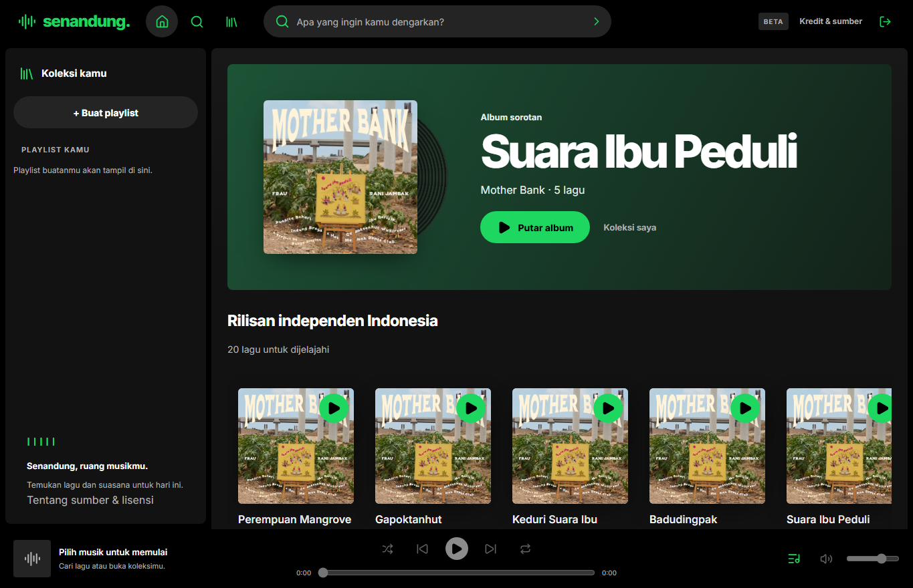

# Senandung — Taste Your Music

Senandung adalah pemutar web untuk musik independen Indonesia. Mulai dari *Suara Ibu Peduli* karya Mother Bank, telusuri rekaman Raja Kirik dan Rani Jambak, atau susun playlist pribadi dari tautan lagu YouTube. Pemutar tetap aktif saat pendengar berpindah dari beranda ke koleksi.

**Website memerlukan login pemilik.** Tampilan beranda dapat dilihat di bawah ini. [Buka Senandung](https://senandung-taste-your-music.vercel.app)

*Sampul album dalam tangkapan layar berasal dari rilis Mother Bank di Yes No Wave Music.* [Suara Ibu Peduli](https://yesnowave.com/releases/yesno122/)

## Mendengarkan di Senandung

| Sumber | Pengalaman mendengarkan |
| --- | --- |
| Yes No Wave Music | Cari rekaman berdasarkan judul, artis, atau album. Putar lagu penuh dan lanjutkan ke lagu berikutnya dalam antrean. |
| YouTube dan YouTube Music | Tempel tautan satu lagu ke playlist. Senandung mengambil judul, kanal, dan sampul, lalu menampilkan pemutar resmi. Pemilik video menentukan izin pemutaran di situs lain. |
| Apple Music | Pilih **Dengar cuplikan** pada rilisan sorotan. Cuplikan terbuka di beranda dan pemutar utama dijeda agar kedua sumber audio tidak berbunyi bersamaan. |

Playlist dan lagu yang disukai tersimpan di browser perangkat yang digunakan. Menghapus data situs juga menghapus koleksi pribadi pada perangkat tersebut.

## Menjalankan secara lokal

Gunakan **Node.js 24** dan **npm**. Dari direktori proyek, pasang dependensi dengan `npm ci --ignore-scripts`.

Buat `.env.local` di direktori yang sama dengan `package.json`, lalu isi kedua variabel berikut sebelum menjalankan aplikasi.

| Variabel server | Nilai |
| --- | --- |
| `SENANDUNG_ACCESS_USER` | Nama pengguna pemilik, maksimal 100 karakter dan tanpa tanda titik dua. |
| `SENANDUNG_ACCESS_PASSWORD` | Kata sandi acak dan unik sepanjang 24–256 karakter. Simpan nilainya di pengelola kata sandi. |

Jalankan `npm run dev`, lalu masuk melalui [halaman login lokal](http://127.0.0.1:3000/login). Untuk menguji build produksi di komputer sendiri, jalankan `npm run build` lalu `npm start`.

## Teknologi dan deployment

Antarmuka menggunakan Next.js App Router, React, dan TypeScript. Metadata pencarian tersimpan dalam JSON. Server mengarahkan pemutar ke audio rilis label, sementara koleksi pengguna disimpan melalui `localStorage`. [Metadata katalog](data/indonesian-releases.json)

Untuk Vercel, gunakan Node.js 24 dan atur kedua variabel akses di environment **Production** sebelum deploy. Konfigurasi repository menjalankan `npm run build` beserta langkah persiapan SQLite. [Konfigurasi Vercel](vercel.json)

## Kredit

Rekaman dan sampul katalog berasal dari Yes No Wave Music untuk pemutaran nonkomersial. Halaman **Kredit, sumber & privasi** di aplikasi memuat atribusi penyedia. Antarmuka memakai ikon Lucide dan font Inter. [Yes No Wave Music](https://yesnowave.com/) · [Lisensi Inter](licenses/Inter-OFL.txt)
